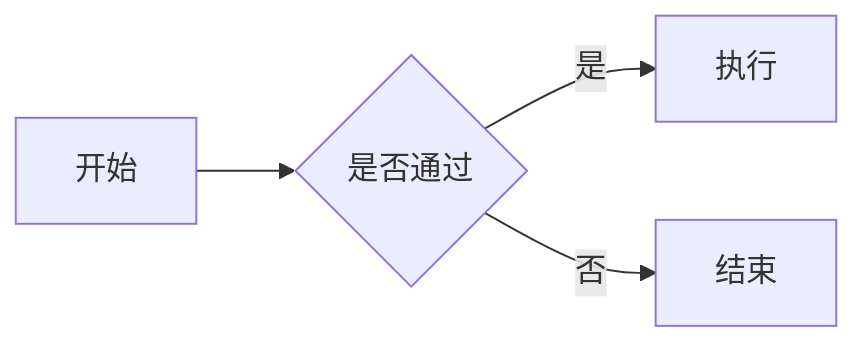

# MGBlog

MGBlog 是面向 Typecho 1.3.0 的 MGHUB 团队博客主题，现代化、简洁的响应式双栏设计：侧栏展示全体成员头像，点击进入成员个人主页；成员可自行编写介绍并配置 GitHub 等社交链接；支持自定义网站 LOGO 与 Favicon。MGBlog 基于 [SaBlog2026](https://www.samool.com)（原作者 SAMOOL，MIT License）改造，在此向原作者致谢。

## 主要能力

- 桌面端主内容 + 侧栏双栏布局，平板和手机自动转换为单栏。
- 侧栏“MGHUB 成员”头像网格自动收录所有成员主页，点击头像进入成员个人详情页。
- 成员主页为独立页面 + “MGHUB 成员主页”模板，成员自行编写正文；编辑页直接提供带说明的头像、角色、链接字段，无需查阅文档。
- 左上角品牌位支持自定义 LOGO 图片地址，留空时显示默认图标。
- 支持自定义 Favicon（浏览器标签页图标），留空时回退网站根目录 favicon.ico。
- 文章列表采用纯文字卡片，不加载或展示文章封面图片。
- 完整 Markdown 排版：标题、引用、代码、表格、任务列表、图片、脚注、详情块等。
- 文章内 Mermaid 图表按需渲染，支持流程图、时序图、类图、状态图和 ER 图，可在图形/代码之间切换并全屏预览。
- 自动读取正文 H1-H3，并按一级、二级、三级结构生成目录；桌面端显示在侧栏，手机端折叠显示。
- 首页显示文章分类；文章页不显示分类，并将文章目录置于侧栏最后，目录滚动到页头下方后固定，超高时在侧栏内部独立滚动。
- 代码块一键复制、Mermaid 源码回看、表格窄屏滚动、内容图片懒加载。
- Typecho 1.3.0 原生评论结构适配，支持长评论和嵌套回复。
- 首页右侧支持可配置友情链接、最新文章和最新评论，分类采用两列图标卡片。
- 首页输出 `WebSite + Blog + Person`、文章输出 `BlogPosting` JSON-LD，并补齐 canonical、robots、Open Graph 与文章时间信号。
- 支持 Google Search Console 验证、RSS 自动发现和搜索/AI 爬虫友好的服务端语义 HTML。
- 系统深浅色偏好、手动切换与本地记忆。
- 无 jQuery、无前端框架、无外部字体、无第三方 CDN。

## 安装

1. 安装或升级到 Typecho 1.3.0，并在操作前备份数据库和 `/usr` 目录。
2. 将整个 `MGBlog` 文件夹上传到 Typecho 的 `/usr/themes/` 目录。
3. 登录 Typecho 后台，进入“控制台 → 外观”，启用 `MGBlog`。
4. 进入“设置外观”填写品牌文字、网站 LOGO、Favicon、默认作者名称、备案号、强调色和页脚文字。
5. 通知成员按照下文“成员主页”一节创建个人页面，发布后侧栏自动出现成员头像。
6. 如需启用 AI 爬虫策略，将项目交付目录 `site-root/robots.txt` 和 `site-root/llms.txt` 上传到网站根目录；主题目录中的同名文件不会自动生效。
7. 清理站点/CDN 缓存后，在桌面和手机端检查首页、正文、独立页面、成员主页和评论。

主题切换不会主动修改文章、分类、标签或评论数据，但切换前仍建议完成数据库与主题目录备份。

## Markdown 与目录

Typecho 负责将 Markdown 转换为 HTML，主题负责显示转换结果。目录默认读取正文 `H1`、`H2`、`H3`：

```markdown
# 第一章

## 1.1 小节

### 1.1.1 说明
```

如果正文没有有效的 H1-H3 文字标题，目录模块会自动隐藏。图片型或空文字标题不会进入目录；目录功能可以在主题设置中全局关闭。

### Mermaid 图表

使用带 `mermaid` 语言标识的 Markdown 围栏代码块即可生成图表：

````markdown

````

主题支持 `flowchart`、`sequenceDiagram`、`classDiagram`、`stateDiagram` 和 `erDiagram`。图表默认显示图形，可切换回原始代码并继续使用复制按钮；图形可进入全屏预览，按 Esc 或“退出全屏”返回。运行时采用主题内置的 Mermaid 11.17.2，仅在文章实际出现 Mermaid 代码块时加载；渲染错误时保留原始代码，不影响文章其他内容。

## 成员主页

每位 MGHUB 成员通过一个独立页面维护个人主页，发布后侧栏自动收录，无需管理员修改主题设置。

1. 后台选择“创建 → 独立页面”，标题填写成员名称（如“明关”），可按需自定义缩略名（slug）。
2. 在页面右侧“选项”栏的“自定义模板”下拉框中选择 **MGHUB 成员主页**；选择后模板下方会出现蓝色操作提示，下方“自定义字段”区会自动展开。
3. 直接在已生成的字段中填值（均为可选，留空的字段在主页自动隐藏）：

| 字段名 | 内容示例 | 说明 |
|---|---|---|
| 成员头像 | `https://example.com/avatar.png` 或站内地址 | 头像图片地址，留空时使用默认头像 |
| 角色 / 身份 | `全栈工程师 · 技术研究` | 一句话身份，显示在名称下方 |
| GitHub 地址 | `https://github.com/name` | 自动补全 https:// |
| 联系邮箱 | `name@example.com` | 自动生成邮件按钮 |
| 个人网站 | `https://example.com` | 个人主页地址 |
| 其他链接 | `知乎\|https://zhihu.com/people/name` | 每行一条，格式“名称\|URL” |
| 关联后台用户名 | `mingguan` | 仅用于标识成员与后台账号的对应关系，不影响文章作者链接 |

> 以上字段仅在选择“MGHUB 成员主页”模板后显示，普通独立页面和文章不会出现这些字段。
>
> 说明：评论头像与成员主页头像相互独立——评论头像由 MGAvatar 插件在「个人设置」中维护；文章作者名始终链接到该作者的文章归档页，可查看其全部文章。

4. 在正文区域用 Markdown 编写个人介绍、研究方向、技术栈、方法分享或生活分享。
5. 发布页面：侧栏“MGHUB 成员”区域立即出现该成员头像，点击即进入其个人主页；成员主页不会出现在顶部导航中。

`其他链接` 字段支持任意数量的链接，主题会根据名称与地址自动匹配 GitHub、X/Twitter、微博、知乎、B 站、邮箱、RSS 等图标，无法识别时显示通用链接图标。头像、LOGO 与 Favicon 图片可先在“撰写文章”页面通过编辑器上传，再复制图片链接粘贴到对应字段。

## PC 自适应宽度

960px 以上保持双栏布局，并按视口宽度自动选择容器：1440px→1320px、1680px→1520px、1920px→1720px、2560px→2200px、3200px 及以上→2600px。侧栏同步从 300px 逐步增加到 380px，使 2K/4K 屏幕减少无效留白，同时避免侧栏控件被过度拉伸。960px 及以下继续使用原有单栏布局。

## 主题设置

- 页头品牌文字
- 网站 LOGO 地址（留空时显示默认图标）
- 网站 Favicon 地址（留空时请求根目录 favicon.ico）
- 默认作者名称（用于文章元信息与 SEO）
- 备案号（留空时不显示工信部备案链接）
- SEO 作者主页 URL
- 首页和归档页默认分享图片 URL
- Google Search Console 验证码
- 六位十六进制强调色
- 默认浅色、深色或跟随系统
- 文章目录开关
- 分类、最新文章和订阅入口开关
- 首页最新评论开关（默认显示最近 5 条已审核评论）
- 友情链接（每行 `名称|URL|简短说明`，说明可省略）
- 页脚文字（可以留空）

友情链接留空时不显示栏目；仅接受 `http://` 或 `https://` 地址。

## SEO、Google 与 AI 爬虫

- 首页根 URL 输出唯一的 `WebSite`、`Blog` 和 `Person` JSON-LD；文章页输出 `BlogPosting`，包含永久链接、摘要、作者、分类、标签、发布时间和修改时间。
- 文章存在正文图片时，主题只把第一张相关图片用于文章 Open Graph/JSON-LD，不会重新在文章列表展示或加载封面；无文章图片时不会用头像冒充文章图片。
- 公开页面允许完整摘要和大图预览；站内搜索结果使用 `noindex,follow`，404 使用 `noindex,nofollow`。
- Typecho 的 RSS 2.0 与 Atom 自动发现继续保留。当前 `https://www.samool.com/feed/` 可作为 Google 接受的近期 URL sitemap。
- `site-root/robots.txt` 明确允许 Googlebot、OAI-SearchBot、Claude-SearchBot，以及 GPTBot、ClaudeBot、Google-Extended 等训练型爬虫；上传该文件即代表站点选择允许这些用途。
- `site-root/llms.txt` 是 AI 工具的辅助入口，属于社区提案，不是 Google 排名或收录机制，不能替代 HTML、RSS、robots.txt 或 Search Console。
- 部署后应在 Google Search Console 提交 RSS 或完整 XML sitemap，并使用 URL Inspection、Rich Results Test 与 Schema.org Validator 检查公网实际输出。

## 目录结构

```text
MGBlog/
├─ assets/
│  ├─ css/style.css
│  ├─ img/default-avatar.png
│  ├─ js/theme.js
│  └─ vendor/mermaid/
│     ├─ mermaid.min.js
│     └─ LICENSE
├─ components/post-card.php
├─ 404.php
├─ archive.php
├─ comments.php
├─ footer.php
├─ functions.php
├─ header.php
├─ index.php
├─ member.php
├─ page.php
├─ post.php
├─ sidebar.php
├─ screenshot.png
└─ style.css
```

## 兼容与边界

- 目标版本：Typecho 1.3.0。
- 不依赖 Handsome 主题函数，不会自动迁移 Handsome 的主题设置。
- Handsome 专用短代码是否能显示，取决于短代码由插件、文章 HTML 还是 Handsome 本身实现。正式切换前应抽样验证旧文章。
- 评论增强、AI 摘要、点赞、豆瓣、音乐播放器等功能不属于本主题核心；如需保留，应作为独立插件或后续模块接入。
- SEO 元数据与结构化数据只能帮助爬虫发现和理解内容，不保证搜索引擎收录、排名、富结果或 AI 引用。

## 致谢与上游归属

MGBlog 基于 **SaBlog2026** 改造：

- 上游项目：SaBlog2026（Markdown 优先的双栏 Typecho 博客主题）
- 原作者：SAMOOL（https://www.samool.com）
- 许可证：MIT License
- MGBlog 对 SaBlog2026 的主要改动：成员头像网格与成员主页模板、编辑页字段引导、网站 LOGO / Favicon 自定义、主题更名与署名变更。

## 许可证

MGBlog 与上游 SaBlog2026 均采用 MIT License，LICENSE 文件中同时保留双方版权声明。内置 Mermaid 11.17.2 采用 MIT License，许可证原文位于 `assets/vendor/mermaid/LICENSE`。`assets/img/default-avatar.png` 由站点所有者提供，其图像著作权与使用权限独立于主题代码的 MIT 许可。
